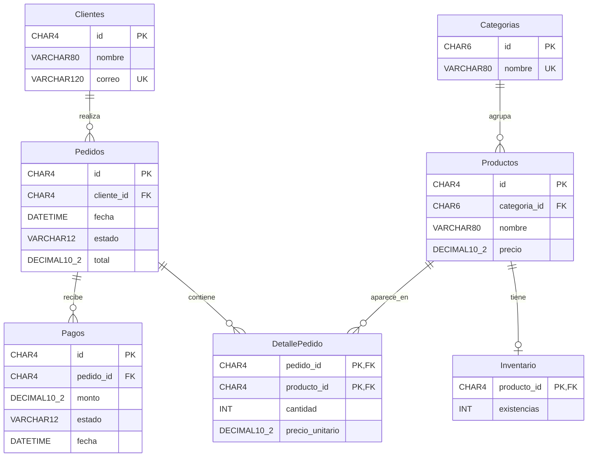

# Diagrama entidad–relación de `tienda` (propuesta)

> **Estado:** este es el diseño propuesto para ampliar el ejemplo MySQL. `projects/tienda-mysql/tienda.sql` todavía crea solo `Clientes`, `Pedidos`, `Productos` y `DetallePedido`; las otras tres tablas y algunos cambios **no están implementados allí**. La versión de siete tablas está escrita por separado para PostgreSQL en `projects/tienda-postgres/tienda.sql`; sus nombres de tabla y tipos se adaptaron a ese motor. No ejecutes consultas basadas en este diagrama contra el esquema MySQL actual sin adaptarlo antes.

**Cómo leerlo:** `PK` identifica una fila; `FK` apunta a otra tabla; `UK` indica un valor único. `||--o{` significa «uno a cero o muchos»; `||--o|`, «uno a cero o uno». Tipos como `DECIMAL10_2` representan `DECIMAL(10,2)` en MySQL; la implementación PostgreSQL utiliza `NUMERIC(10,2)` y `TIMESTAMPTZ` en lugar de `DATETIME`. En `DetallePedido`, **`pedido_id` y `producto_id` forman juntos la clave primaria**: un producto aparece como máximo una vez por pedido, aunque el mismo producto puede aparecer en otros pedidos.

## Recorrido de una compra

- Ana (`Clientes.id = C-01`) realiza A-17 (`Pedidos.id = A-17`).
- A-17 tiene una línea en `DetallePedido`: cuaderno (`P-01`), cantidad **3**, `precio_unitario` **S/ 12**; subtotal **S/ 36**.
- `Productos.precio` es el precio **actual** del cuaderno. `DetallePedido.precio_unitario` conserva el precio **al comprar**, aunque el precio actual cambie.
- A-17 registra un `total` de **S/ 36**. Un pago confirmado por **S/ 36** podría registrarse en `Pagos`; otros pedidos pueden no tener pagos todavía.
- Como ejemplo de pedido con más de un producto, A-23 tiene dos líneas: **2 cuadernos × S/ 12 + 1 lapicero × S/ 5 = S/ 29**. Se carga en el script PostgreSQL, **no en el script MySQL actual**.

## Reglas y límites del diseño

- `Productos.categoria_id` referencia `Categorias.id`; `Inventario.producto_id` referencia `Productos.id` y es único por ser su clave primaria. Un producto puede no tener todavía fila de inventario.
- Cada pedido pertenece a un cliente. Cada línea pertenece a un pedido y a un producto. Un pedido puede tener cero o más pagos; se admitirían pagos parciales si la lógica de la tienda los permite.
- Los campos obligatorios, claves foráneas y restricciones propuestas deben definirse en el SQL. Cantidades y pagos deben ser positivos; existencias, precios y total no deben ser negativos.
- El modelo permite técnicamente un pedido sin líneas; la regla de que **todo pedido confirmado tenga al menos una línea** requiere lógica adicional o una operación controlada.
- `Pedidos.total` es un valor guardado, **no calculado automáticamente** por las relaciones: hay que mantenerlo coherente con `SUM(cantidad * precio_unitario)`. Tampoco se deduce automáticamente el estado del pedido de los pagos ni se descuenta inventario al insertar una línea. Esas operaciones requieren reglas y, al confirmar una compra, una transacción que mantenga los datos consistentes.
- La propuesta elimina `Pedidos.detalle`, campo de texto presente en el SQL actual: las líneas de `DetallePedido` pasan a ser la fuente estructurada de los productos comprados. Las consultas y diapositivas que usan ese campo deberán adaptarse cuando se implemente el nuevo esquema.
